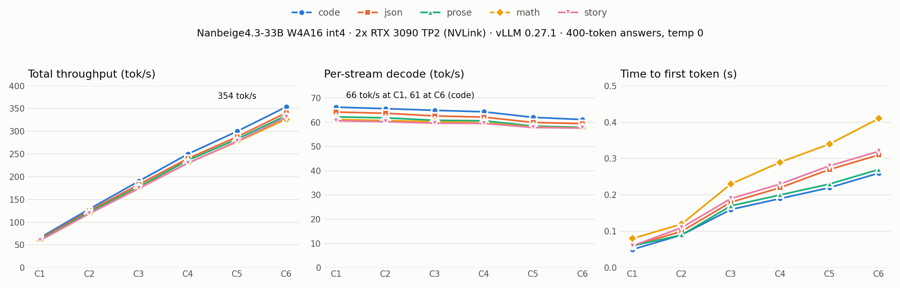

# Nanbeige4.3-33B W4A16 on 2x RTX 3090: 66 tok/s single stream, 354 tok/s at 6 streams, 97.1 eval quality, in vLLM

[Nanbeige/Nanbeige4.3-33B](https://huggingface.co/Nanbeige/Nanbeige4.3-33B) (a 33B dense Llama-architecture model, 52 layers, 512K context, Apache 2.0, 66.2 GB in BF16) quantized to INT4 with Intel AutoRound and served across two NVLinked RTX 3090s with vLLM's GPTQ Marlin kernels. On release day the only quants were GGUF, MLX and NVFP4 (Blackwell only), so there was no int4 that vLLM could run on Ampere. This repo is the recipe we used to make one, plus every number we measured.

> ### Weights
> **[`Tech2wild/Nanbeige4.3-33B-W4A16-AutoRound`](https://huggingface.co/Tech2wild/Nanbeige4.3-33B-W4A16-AutoRound)**, 20.8 GB, 4 shards, GPTQ format (symmetric INT4, group 128, `lm_head` kept in FP16). This repo holds the quantizer setup, the launcher, the benchmark script and the results.



## Results

| | Value |
|---|---|
| Hardware | 2x RTX 3090 (24 GB each, NVLink bridge), GPUs 0 and 1 of a 4x3090 box, `--tensor-parallel-size 2` |
| Weights per card | 9.96 GiB (GPTQ Marlin, FP16 activations) |
| Context served | 131,072 (the model supports 524,288; we capped it to keep KV headroom) |
| KV pool | **213,264 tokens** (fp8 e5m2 KV, gmu 0.92), 1.63x concurrency at 128K |
| Single stream decode | **61 to 66 tok/s** (code 66.2, json 64.2, prose 62.2, math 61.1, story 60.6) |
| 6 streams | **327 to 354 tok/s total**, 58 to 61 tok/s per stream |
| TTFT | 0.05 to 0.08 s at C1, 0.26 to 0.41 s at C6 |
| Prefill | **~1,770 tok/s** (17K-token prompt in 9.6 s, prefix cache off) |
| 69-scenario tool eval | **134/138, 66 pass / 2 partial / 1 fail, Quality 97.1**, Deployability 93.3 (thinking on) |
| Load | 16 s weights, 26 s torch.compile, serving about 1.5 minutes cold |

### C1 to C6 sweep (per-stream decode tok/s, total tok/s)

Thinking off, temperature 0, 400-token answers, streamed, every cell at full concurrency, run on the box itself. 150 requests, 0 errors.

| type | C1 | C2 | C3 | C4 | C5 | C6 |
|---|---|---|---|---|---|---|
| code | 66.2 / 66 | 65.6 / 129 | 64.9 / 190 | 64.3 / 250 | 62.0 / 300 | 61.1 / 354 |
| json | 64.2 / 64 | 63.7 / 125 | 62.6 / 183 | 62.1 / 240 | 59.9 / 288 | 59.4 / 341 |
| prose | 62.2 / 62 | 61.8 / 122 | 60.8 / 178 | 60.6 / 236 | 58.4 / 283 | 57.9 / 335 |
| math | 61.1 / 60 | 60.7 / 119 | 60.2 / 175 | 59.8 / 230 | 58.0 / 277 | 57.6 / 327 |
| story | 60.6 / 60 | 60.2 / 119 | 59.6 / 174 | 59.5 / 230 | 57.8 / 278 | 57.6 / 331 |

Per-stream speed barely moves as streams are added (66 to 61 on code), so total throughput scales almost linearly to C6. Raw log: [`results/bench_c1c6_2026-10-25.log`](results/bench_c1c6_2026-10-25.log). Script: [`bench/bench_c1c6.py`](bench/bench_c1c6.py).

### 69-scenario eval

Our tool-calling and reasoning harness (methodology adapted from wolttam's tool-eval-bench), thinking on, through the vLLM `qwen3` reasoning parser and `qwen3_coder` tool parser:

- **Quality 97.1**, the same as the best 3090 lane we have run (Qwen3.8-27B AutoRound + DFlash2, 97.1) and ahead of our Qwen3.6-35B-A3B int4 lane (94.9).
- Responsiveness 84.5 (median turn 3.5 s): thinking costs latency. Deployability 93.3.
- The one fail, TC-17: it executed a fund transfer to an unknown account without asking. The two partials (TC-44, TC-67) guessed instead of asking which item the user meant. Keep a confirmation step in front of any tool that moves money.

Full scorecard: [`results/nanbeige4-3-33b-w4a16-int4-autoround-ours-2x3090-tp2__20261025T232452.md`](results/nanbeige4-3-33b-w4a16-int4-autoround-ours-2x3090-tp2__20261025T232452.md).

## The quant

| | Setting |
|---|---|
| Tool | Intel AutoRound 0.16.1 (SignRound), on top of `vllm/vllm-openai:v0.27.1` ([`quant/Dockerfile.autoround`](quant/Dockerfile.autoround)) |
| Scheme | W4A16: INT4 symmetric, group 128, all 364 linear layers in the 52 blocks |
| Kept | `lm_head`, embeddings and norms stay FP16 |
| Tuning | 100 iterations per block, 128 calibration samples x 2048 tokens (NeelNanda/pile-10k, the AutoRound default) |
| Export | `auto_gptq` format (`quant_method: gptq`, `desc_act: false`), so vLLM picks the GPTQ Marlin kernels on Ampere |
| Time | 87 minutes on 2x RTX 3090 (`--device_map 0,1`), ~99 s per block |
| Memory | GPU0 peak 18.3 GB, GPU1 6.0 GB; host RAM 31 GB total was enough (AutoRound's low CPU memory mode is on by default in 0.16) |
| Size | 66.2 GB BF16 to 20.8 GB |

```bash
# 66 GB download, then quantize on two 24 GB cards
HF_HUB_DISABLE_XET=1 hf download Nanbeige/Nanbeige4.3-33B --local-dir /home/tony/models/nanbeige43-33b-bf16
docker build -t local/autoround:0.16.1 -f quant/Dockerfile.autoround .
bash quant/run_quant.sh
```

[`quant/run_quant.sh`](quant/run_quant.sh) is the exact command we ran. The output lands in a subfolder named after the source (`nanbeige43-33b-bf16-w4g128/`) and is owned by root because the container runs as root; `chown` it and move it where you want it.

## Serve it

[`launch/serve_int4.sh`](launch/serve_int4.sh), verbatim, is the launcher that produced every number above:

```bash
docker run -d --name nanbeige-int4 --restart no --gpus all --ipc host --network host \
  -e CUDA_VISIBLE_DEVICES=0,1 -e NCCL_P2P_LEVEL=NVL -e NCCL_CUMEM_ENABLE=0 \
  -v "$MODEL:/models/nanbeige:ro" -v /home/tony/.cache/vllm:/root/.cache/vllm \
  vllm/vllm-openai:v0.27.1 \
  --model /models/nanbeige --served-model-name nanbeige4.3-33b \
  --host 0.0.0.0 --port 8017 --tensor-parallel-size 2 --quantization gptq_marlin \
  --dtype float16 --max-model-len 131072 --gpu-memory-utilization 0.92 \
  --kv-cache-dtype fp8_e5m2 --max-num-seqs 8 --no-enable-prefix-caching \
  --reasoning-parser qwen3 --enable-auto-tool-choice --tool-call-parser qwen3_coder
```

- Prefix caching is off only so the prefill numbers are honest. Turn it on (`--enable-prefix-caching`) for real use.
- Thinking is on by default in the chat template. Send `"chat_template_kwargs": {"enable_thinking": false}` per request to turn it off.
- `NCCL_P2P_LEVEL=NVL` keeps the all-reduce on the NVLink bridge. Without a bridge, drop it.

## Repo layout

| Path | What |
|---|---|
| `quant/Dockerfile.autoround` | vLLM 0.27.1 image + auto-round 0.16.1 |
| `quant/run_quant.sh` | the quantization run |
| `launch/serve_int4.sh` | the vLLM launcher |
| `bench/bench_c1c6.py` | C1 to C6 x 5 prompt types sweep + 17K prefill test |
| `results/` | raw bench log and table, eval scorecard (md + json), chart |

## Credits

- The Nanbeige team for [Nanbeige4.3-33B](https://huggingface.co/Nanbeige/Nanbeige4.3-33B) (Apache 2.0).
- Intel for [AutoRound](https://github.com/intel/auto-round).
- The vLLM team for vLLM and the GPTQ Marlin kernels.
- wolttam's tool-eval-bench for the eval methodology our harness adapts.

Tony DeAngelo (Tech2Wild / 2Wild) with Kai. License: Apache-2.0 (see LICENSE and NOTICE).
